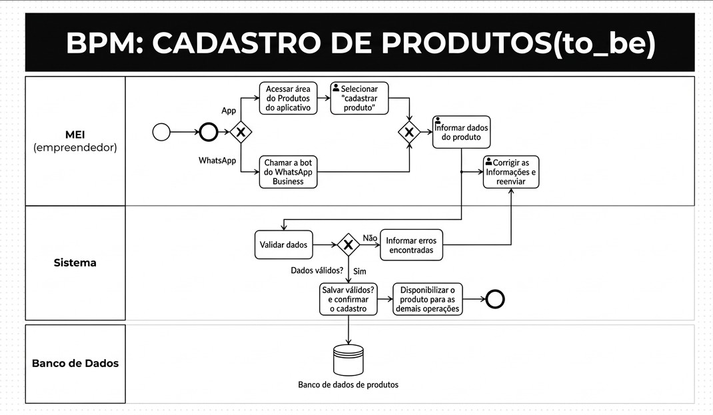
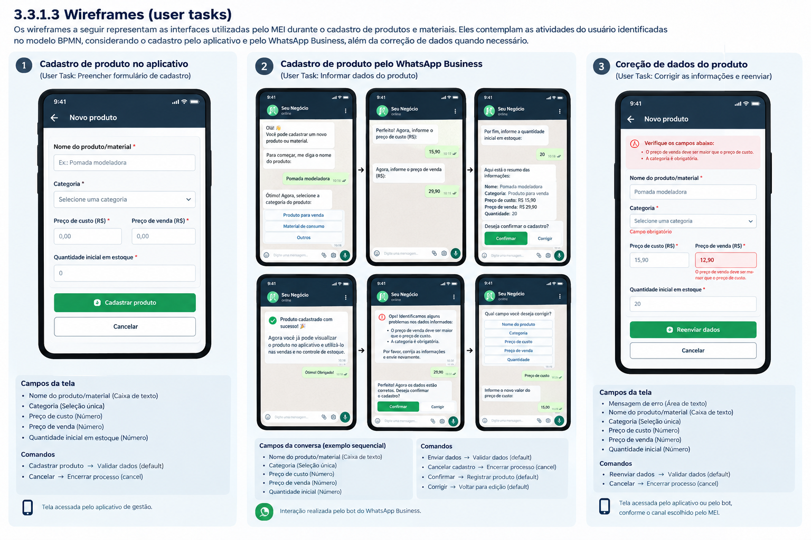

## 3. Modelagem dos Processos de Negócio

> **Links Úteis**:
> - [Modelagem de Processos AS-IS x TO-BE](https://dheka.com.br/modelagem-as-is-to-be/)
> - [20 Dicas Práticas de Modelagem de Processos](https://dheka.com.br/20-dicas-praticas-de-modelagem-de-processos/)

### 3.3. Processo 1 – Cadastro de Produtos e Materiais

#### Descrição do processo

O processo de cadastro de produtos e materiais tem como objetivo permitir que o Microempreendedor Individual (MEI) registre os produtos comercializados e os materiais utilizados em seu negócio, mantendo as informações necessárias para o controle de estoque e para os cálculos financeiros realizados pelo sistema.

O cadastro poderá ser realizado por dois canais: a interface do aplicativo de gestão ou o bot integrado ao WhatsApp Business. Essa alternativa busca reduzir o esforço do empreendedor, permitindo que ele escolha o canal mais conveniente para sua rotina, sem precisar necessariamente abrir o aplicativo para cadastrar um produto.

**Onde acontece:** no aplicativo de gestão ou na conversa com o bot do WhatsApp Business. A validação e o registro das informações ocorrem por meio dos mecanismos utilizados pela solução.

#### Participantes

- **MEI/empreendedor:** fornece as informações necessárias para o cadastro e corrige eventuais dados inválidos.
- **Bot do WhatsApp Business:** conduz a conversa, solicita as informações do produto e apresenta mensagens de retorno quando o cadastro é realizado por esse canal.
- **Aplicativo/sistema:** recebe e valida os dados, registra o produto e disponibiliza suas informações para consulta.
- **Mecanismo de armazenamento:** mantém os dados cadastrados para que possam ser consultados e utilizados nos demais processos da solução.

#### Evento de início

O MEI decide cadastrar um novo produto ou material e inicia a operação pelo aplicativo ou pelo WhatsApp Business.

#### Tarefas do processo

1. Escolher o canal de cadastro.
2. Acessar a área de produtos do aplicativo ou iniciar a conversa com o bot.
3. Informar o nome, a categoria, o preço de custo, o preço de venda e a quantidade inicial.
4. Enviar os dados para validação.
5. Verificar se as informações estão completas e válidas.
6. Solicitar a correção dos dados quando forem identificados erros.
7. Registrar o produto quando todas as informações estiverem válidas.
8. Confirmar o cadastro e disponibilizar o produto para consulta.

#### Evento de fim

O produto é registrado com sucesso e fica disponível para consulta no aplicativo e utilização nos processos seguintes.

#### Produto final

Produto ou material cadastrado, contendo nome, categoria, preço de custo, preço de venda e quantidade inicial em estoque.

Produto ou material cadastrado, contendo nome, categoria, preço de custo, preço de venda e quantidade inicial em estoque.
#### 3.3.1.1 Modelagem BPMN

#### 3.3.1.2 Detalhamento das atividades do usuário (user tasks)

#### Detalhamento das atividades

As atividades do usuário representam as interações realizadas pelo MEI durante o processo de cadastro de produtos e materiais. Conforme o modelo BPMN apresentado, essas atividades envolvem a seleção da opção de cadastro no aplicativo, o fornecimento dos dados do produto e a correção das informações quando o sistema identifica erros.

O cadastro poderá ser iniciado pelo aplicativo ou pelo bot do WhatsApp Business. As atividades descritas a seguir consideram os campos necessários para o cadastro e os comandos que direcionam o fluxo para as próximas etapas do processo.

**Nome da atividade 1 — Selecionar a opção "Cadastrar produto"**

Esta atividade permite que o MEI acesse a funcionalidade de cadastro de produtos e materiais pela interface do aplicativo.

| **Campo**          | **Tipo**        | **Restrições**                                           | **Valor default**           |
| ---                | ---             | ---                                                      | ---                         |
| Opção de cadastro  | Seleção única   | Deve permitir selecionar a opção "Cadastrar produto"     | Nenhuma opção selecionada   |

| **Comandos**       | **Destino**                | **Tipo** |
| ---                | ---                        | ---      |
| Cadastrar produto  | Informar dados do produto  | default  |

**Nome da atividade 2 — Informar dados do produto**

Esta atividade permite que o MEI forneça as informações necessárias para cadastrar um produto ou material. A interação poderá ocorrer pelo formulário do aplicativo ou pela conversa com o bot do WhatsApp Business.

| **Campo**                      | **Tipo**        | **Restrições**                                                   | **Valor default**            |
| ---                            | ---             | ---                                                              | ---                          |
| Nome do produto/material       | Caixa de texto  | Obrigatório; não pode conter apenas espaços                      | Vazio                        |
| Categoria                      | Seleção única   | Obrigatória; deve corresponder a uma categoria disponível        | Nenhuma categoria selecionada |
| Preço de custo                 | Número          | Obrigatório; deve ser maior ou igual a zero                      | Vazio                        |
| Preço de venda                 | Número          | Obrigatório; deve ser maior ou igual a zero                      | Vazio                        |
| Quantidade inicial em estoque  | Número          | Obrigatória; deve ser um número inteiro maior ou igual a zero    | 0                            |

| **Comandos**  | **Destino**     | **Tipo** |
| ---           | ---             | ---      |
| Enviar dados  | Validar dados   | default  |

Após o envio, o sistema verifica se as informações estão completas e atendem às regras de validação definidas para o cadastro. Se forem identificados erros, o processo segue para a atividade de correção. Caso os dados sejam válidos, o sistema prossegue para o registro do produto.

**Nome da atividade 3 — Corrigir as informações e reenviar**

Esta atividade é executada quando o sistema identifica informações ausentes ou inválidas durante a validação. O MEI recebe uma mensagem indicando os problemas encontrados, corrige os campos necessários e envia novamente as informações para uma nova validação.

| **Campo**                      | **Tipo**        | **Restrições**                                                        | **Valor default**           |
| ---                            | ---             | ---                                                                   | ---                         |
| Mensagem de erro               | Área de texto   | Exibida pelo sistema; deve indicar os dados que precisam de correção  | Mensagem gerada pelo sistema |
| Nome do produto/material       | Caixa de texto  | Obrigatório; não pode conter apenas espaços                           | Último valor informado      |
| Categoria                      | Seleção única   | Obrigatória; deve corresponder a uma categoria disponível             | Última categoria informada  |
| Preço de custo                 | Número          | Obrigatório; deve ser maior ou igual a zero                           | Último valor informado      |
| Preço de venda                 | Número          | Obrigatório; deve ser maior ou igual a zero                           | Último valor informado      |
| Quantidade inicial em estoque  | Número          | Obrigatória; deve ser um número inteiro maior ou igual a zero         | Último valor informado      |

| **Comandos**                     | **Destino**     | **Tipo** |
| ---                              | ---             | ---      |
| Reenviar informações corrigidas  | Validar dados   | default  |

Após o reenvio, o sistema realiza uma nova validação. Se os dados continuarem inválidos, o MEI deverá corrigir as informações novamente. Se estiverem corretos, o produto será registrado e ficará disponível para consulta no aplicativo.
### 3.4 Wireframe

### 3.3. Processo 2 – Registro de Vendas

#### Descrição do processo

O processo de registro de vendas tem como objetivo permitir que o Microempreendedor Individual (MEI) registre as vendas realizadas em seu negócio, informando os produtos comercializados, as respectivas quantidades e os valores da venda. Essa rotina permite manter o histórico de vendas organizado, além de atualizar automaticamente o estoque conforme os produtos vendidos.

O registro será realizado por meio da interface do aplicativo de gestão. A solução busca facilitar o controle das operações comerciais do empreendedor, centralizando as informações das vendas e reduzindo a necessidade de atualizações manuais do estoque.

**Onde acontece:** na interface do aplicativo de gestão. A validação dos dados, o registro da venda e a atualização do estoque ocorrem por meio dos mecanismos utilizados pela solução.

#### Participantes

- **MEI/empreendedor:** informa os produtos vendidos, suas respectivas quantidades e valores, além de corrigir eventuais inconsistências identificadas durante o registro.
- **Aplicativo/sistema:** recebe e valida os dados da venda, verifica as informações fornecidas, registra a operação, atualiza o estoque e confirma a conclusão do registro.
- **Banco de dados:** armazena as informações das vendas realizadas e mantém os saldos de estoque atualizados conforme os produtos comercializados.

#### Evento de início

O MEI realiza uma venda e identifica a necessidade de registrá-la no aplicativo, iniciando o processo ao acessar a área de Vendas.

#### Tarefas do processo

1. Acessar a área de Vendas do aplicativo.
2. Selecionar a opção "Registrar venda".
3. Informar os produtos comercializados, suas respectivas quantidades e os valores da venda.
4. Enviar os dados para validação pelo sistema.
5. Verificar se as informações fornecidas são válidas e se os produtos estão cadastrados e possuem quantidade suficiente em estoque.
6. Informar os erros encontrados quando forem identificadas inconsistências, permitindo que o MEI corrija as informações e reenvie os dados.
7. Registrar a venda e atualizar automaticamente o estoque quando todas as informações estiverem corretas.
8. Confirmar o registro da venda e disponibilizar as informações atualizadas no aplicativo.

#### Evento de fim

A venda é registrada com sucesso, as informações são armazenadas no banco de dados e o estoque é atualizado de acordo com as quantidades comercializadas. O registro fica disponível para consulta no aplicativo.

#### Produto final

Venda registrada no sistema, contendo os produtos comercializados, suas respectivas quantidades e valores, além do estoque atualizado e do histórico da operação.

#### 3.3.1.1 Modelagem BPMN

#### 3.3.1.2 Detalhamento das atividades do usuário (user tasks)

#### Detalhamento das atividades

As atividades do usuário representam as interações realizadas pelo MEI durante o processo de registro de vendas. Conforme o modelo BPMN apresentado, essas atividades envolvem o acesso à área de Vendas, a seleção da opção de registro, o preenchimento das informações referentes aos produtos comercializados e a correção de eventuais erros identificados pelo sistema.

As atividades descritas a seguir consideram os campos necessários para o lançamento das vendas no aplicativo.

**Nome da atividade 1 — Acessar a área de Vendas do Aplicativo**

Esta atividade permite que o MEI acesse a funcionalidade de registro de vendas diretamente pela interface do aplicativo, iniciando o processo de lançamento de uma nova venda.

| **Campo** | **Tipo** | **Restrições** | **Valor default** |
| --- | --- | --- | --- |
| Área de acesso | Navegação / Menu | Deve permitir acessar a área de Vendas do aplicativo | Tela inicial do aplicativo |

| **Comandos** | **Destino** | **Tipo** |
| --- | --- | --- |
| Acessar Vendas | Selecionar a opção "Registrar venda" | default |

**Nome da atividade 2 — Selecionar a opção "Registrar venda"**

Esta atividade permite que o MEI selecione a funcionalidade de registro de vendas disponível na área de Vendas, direcionando-o para o formulário de lançamento de uma nova operação.

| **Campo** | **Tipo** | **Restrições** | **Valor default** |
| --- | --- | --- | --- |
| Opção de operação | Seleção única | Deve permitir selecionar a opção "Registrar venda" | Nenhuma opção selecionada |

| **Comandos** | **Destino** | **Tipo** |
| --- | --- | --- |
| Registrar venda | Informar produtos, quantidades e valores da venda | default |

**Nome da atividade 3 — Informar produtos, quantidades e valores da venda**

Esta atividade permite que o MEI informe, por meio do formulário do sistema, quais produtos foram comercializados, suas respectivas quantidades e os valores correspondentes à venda.

| **Campo** | **Tipo** | **Restrições** | **Valor default** |
| --- | --- | --- | --- |
| Produto | Seleção única | Obrigatório; deve corresponder a um produto já cadastrado | Nenhum produto selecionado |
| Quantidade vendida | Número | Obrigatório; deve ser um número inteiro maior que zero e não pode ultrapassar o saldo disponível em estoque | Vazio |
| Valor da venda | Número / Monetário | Obrigatório; deve ser um valor maior que zero | Vazio |

| **Comandos** | **Destino** | **Tipo** |
| --- | --- | --- |
| Enviar dados da venda | Validar dados | default |

Após o envio, o sistema verifica se as informações fornecidas são válidas, incluindo a existência dos produtos cadastrados, a quantidade disponível em estoque e os valores informados. Caso sejam identificadas inconsistências, o sistema apresenta os erros encontrados e direciona o processo para a correção das informações. Caso os dados estejam corretos, a venda é registrada e o estoque é atualizado automaticamente.

**Nome da atividade 4 — Corrigir as informações e reenviar**

Esta atividade é executada quando o sistema identifica inconsistências durante a validação dos dados da venda. O MEI visualiza as mensagens de erro apresentadas pelo aplicativo, corrige as informações necessárias e reenvia os dados para uma nova validação.

| **Campo** | **Tipo** | **Restrições** | **Valor default** |
| --- | --- | --- | --- |
| Mensagem de erro | Área de texto | Exibida pelo sistema; deve indicar as informações inválidas ou os problemas encontrados na venda | Mensagem gerada pelo sistema |
| Produto | Seleção única | Obrigatório; deve corresponder a um produto cadastrado | Último valor informado |
| Quantidade vendida | Número | Obrigatório; deve ser um número inteiro maior que zero e compatível com o saldo disponível em estoque | Último valor informado |
| Valor da venda | Número / Monetário | Obrigatório; deve ser um valor maior que zero | Último valor informado |

| **Comandos** | **Destino** | **Tipo** |
| --- | --- | --- |
| Reenviar informações corrigidas | Validar dados | default |

Após o reenvio, o sistema realiza uma nova validação das informações. Caso os dados estejam corretos, a venda é registrada, o estoque é atualizado e o sistema confirma a conclusão da operação. Caso ainda existam inconsistências, o processo retorna para a correção das informações.

### 3.4. Wireframe

### 3.3. Processo 3 – Registro e Controle de Estoque 

#### Descrição do processo
O processo de registro e controle de estoque tem como objetivo permitir que o Microempreendedor Individual (MEI) atualize a quantidade de produtos ou materiais disponíveis em seu negócio, registrando novas entradas (compras de fornecedores), saídas (vendas ou perdas) e ajustes manuais de inventário. Essa rotina garante a precisão das informações e subsidia os alertas de estoque mínimo.
O controle será realizado por meio da interface do aplicativo de gestão. A solução busca organizar a rotina do empreendedor, permitindo que ele atualize o estoque de forma prática e centralizada após uma venda ou o recebimento de mercadorias.

**Onde acontece:** na interface do aplicativo de gestão. A validação e a atualização do saldo em estoque ocorrem por meio dos mecanismos utilizados pela solução. 

#### Participantes

- **MEI/empreendedor:** fornece os dados da movimentação (tipo de operação, produto e quantidade), realiza consultas de saldo e corrige eventuais divergências. 
- **Aplicativo/sistema:** recebe e valida os dados, calcula o novo saldo do estoque, gera alertas de estoque mínimo e disponibiliza o histórico de movimentações. 
- **Mecanismo de armazenamento:** mantém atualizados os saldos de estoque e registra o histórico de todas as entradas e saídas realizadas. 

#### Evento de início

O MEI identifica a necessidade de registrar uma movimentação de estoque (entrada, saída ou ajuste) e inicia a operação acessando o aplicativo. 

#### Tarefas do processo

1. Acessar a área de controle de estoque no aplicativo. 
2. Informar o tipo de movimentação (entrada, saída ou ajuste), o produto e a quantidade movimentada. 
3.Enviar os dados para validação e atualização do saldo. 
4. Verificar se o produto existe e se a quantidade é válida (ex: saldo não pode ficar negativo em caso de saídas, conforme a regra do negócio). 
5. Solicitar a correção dos dados ou avisar sobre saldo insuficiente quando forem identificados erros. 
6. Atualizar o saldo de estoque no sistema quando as informações estiverem corretas. 
7. Confirmar a operação, verificar se o saldo atingiu o limite mínimo e disponibilizar o estoque atualizado para consulta. 
#### Evento de fim

O estoque é atualizado com sucesso, o saldo é recalculado e o registro da movimentação fica disponível no histórico do aplicativo. 

#### Produto final

Estoque atualizado do produto ou material, contendo o novo saldo calculado, o histórico da movimentação e eventuais alertas de reposição. 

#### 3.3.1.1 Modelagem BPMN

#### 3.3.1.2 Detalhamento das atividades do usuário (user tasks)

#### Detalhamento das atividades

As atividades do usuário representam as interações realizadas pelo MEI durante o processo de controle de estoque. Conforme o modelo BPMN apresentado, essas atividades envolvem a seleção da opção de movimentação no menu, o fornecimento dos dados do produto e da quantidade nos campos do sistema, e a validação do saldo.
As atividades descritas a seguir consideram os campos necessários para o lançamento das movimentações no aplicativo.

**Nome da atividade 1 — Selecionar a opção "Movimentar estoque"**

Esta atividade permite que o MEI acesse a funcionalidade de controle de estoque diretamente pela interface do aplicativo. 

| **Campo**          | **Tipo**        | **Restrições**                                           | **Valor default**           |
| ---                | ---             | ---                                                      | ---                         |
| Tipo de operação   | Seleção única   | Deve permitir selecionar entre Entrada, Saída ou Ajuste      | Nenhuma opção selecionada   |

| **Comandos**       | **Destino**                | **Tipo** |
| ---                | ---                        | ---      |
| Prosseguir para lançamento   | Informar dados da movimentação   | default  |

**Nome da atividade 2 — Informar dados da movimentação**

Esta atividade permite que o MEI indique, através do formulário do sistema, qual produto terá o estoque alterado e qual a quantidade correspondente à operação. 

| **Campo**                      | **Tipo**        | **Restrições**                                                   | **Valor default**            |
| ---                            | ---             | ---                                                              | ---                          |
| Produto / Material        | Seleção única   |Obrigatório; deve corresponder a um produto já cadastrado                       | Nenhum produto selecionado                       |
| Quantidade movimentada                       | Número    | Obrigatório; deve ser um número inteiro maior que zero         |Vazio  |
| Motivo / Observação (Opcional)                  | Caixa de texto           | Opcional; texto livre para detalhar o ajuste ou perda                       | Vazio                        |

| **Comandos**  | **Destino**     | **Tipo** |
| ---           | ---             | ---      |
| Enviar movimentação   | Validar estoque e saldo    | default  |

Após o envio, o sistema verifica se a quantidade informada é válida e, no caso de saídas, se há saldo suficiente em estoque. Se houver divergências ou saldo insuficiente, o processo segue para a atividade de correção. Caso os dados estejam corretos, o saldo é atualizado automaticamente. 

**Nome da atividade 3 — Corrigir dados ou quantidade da movimentação**

Esta atividade é executada quando o sistema identifica inconsistências na tentativa de movimentação (como tentar retirar mais produtos do que o saldo atual ou informar valores inválidos). O MEI visualiza a mensagem de erro na tela, ajusta as informações no formulário e reenvia para validação. 

| **Campo**                      | **Tipo**        | **Restrições**                                                        | **Valor default**           |
| ---                            | ---             | ---                                                                   | ---                         |
| Mensagem de erro / Alerta               | Área de texto   |Exibida pelo sistema; indica saldo insuficiente ou dado inválido   | Mensagem gerada pelo sistema |
| Produto / Material        | Seleção única   | Obrigatório; produto selecionado anteriormente                            | Último valor informado      |
| Nova quantidade informada                     | Número    | Obrigatório; compatível com o saldo disponível (para saídas)              | Último valor informado   |

| **Comandos**                     | **Destino**     | **Tipo** |
| ---                              | ---             | ---      |
|Reenviar dados corrigidos   | Validar estoque e saldo    | default  |

Após o reenvio, o sistema realiza uma nova validação. Estando os dados corretos, o estoque é atualizado com sucesso e a operação é concluída no sistema. 
### 3.4 Wireframe

### 3.3. Processo 4 – Geração de Relatórios via WhatsApp

#### Descrição do processo
O processo de Geração de Relatórios via WhatsApp consiste na extração, consolidação e envio automatizado ou sob demanda de relatórios gerenciais e operacionais diretamente para os gestores ou equipes por meio do aplicativo WhatsApp. Ele acontece no sistema corporativo integrado (módulo de relatórios) em conjunto com a API oficial do WhatsApp Business. Participam deste fluxo o Gestor/Usuário solicitante, o Sistema Automatizado e o Servidor/API de Mensageria. O início ocorre a partir da solicitação do relatório pelo gestor (via sistema ou comando no chat) ou por disparo agendado via rotina automática. O fim se dá com a confirmação de entrega do relatório em formato PDF ou planilha na conversa do WhatsApp. As principais tarefas envolvem solicitar e configurar o relatório, processar dados, gerar o arquivo, validar permissões e enviar a mensagem via WhatsApp. Os produtos gerados são o relatório consolidado (em PDF ou Excel) e a notificação enviada no WhatsApp.

#### Participantes

- **MEI/empreendedor:** solicita os relatórios, seleciona as informações desejadas, define o período de consulta e configura a frequência de recebimento, quando necessário.
- **Aplicativo/sistema:** recebe as solicitações, consulta e consolida os dados armazenados, gera os relatórios e verifica as permissões necessárias para o envio.
- **API do WhatsApp Business:** recebe as solicitações de envio do sistema e encaminha os relatórios e notificações para o número de WhatsApp cadastrado pelo empreendedor.
- **Banco de dados:** armazena as informações de vendas, movimentações financeiras e estoque utilizadas na elaboração dos relatórios.

#### Evento de início

O MEI identifica a necessidade de acompanhar os resultados do negócio e solicita a geração de um relatório pelo aplicativo ou por meio de um comando no WhatsApp. O processo também pode ser iniciado automaticamente, conforme a programação de envios previamente configurada.

#### Tarefas do processo

1. Acessar a área de relatórios do aplicativo ou iniciar uma solicitação pelo WhatsApp.
2. Selecionar o tipo de relatório desejado, o período de consulta e o formato do arquivo.
3. Enviar a solicitação para processamento pelo sistema.
4. Consultar e consolidar as informações necessárias no banco de dados.
5. Gerar o relatório no formato selecionado, como PDF ou planilha.
6. Verificar as permissões de acesso e as informações do número de WhatsApp cadastrado.
7. Encaminhar o relatório e a notificação por meio da API do WhatsApp Business.
8. Confirmar o envio e disponibilizar o relatório na conversa do WhatsApp do empreendedor.

#### Evento de fim

O relatório é gerado e encaminhado com sucesso para o WhatsApp cadastrado pelo MEI, ficando disponível para consulta e acompanhamento das informações do negócio.

#### Produto final

Relatório gerencial ou operacional em formato PDF ou planilha, contendo as informações solicitadas pelo MEI, acompanhado de uma notificação enviada diretamente para sua conversa no WhatsApp.

#### 3.3.1.1 Modelagem BPMN

#### 3.3.1.2 Detalhamento das atividades do usuário (user tasks)

#### Detalhamento das atividades

As atividades do usuário representam as interações realizadas pelo MEI durante o processo de geração de relatórios via WhatsApp. Conforme o funcionamento proposto, essas atividades envolvem o acesso à funcionalidade de relatórios, a seleção das informações desejadas e a configuração dos parâmetros necessários para a geração do arquivo.

As atividades descritas a seguir consideram os campos necessários para a solicitação de relatórios no aplicativo de gestão.

**Nome da atividade 1 — Acessar a área de Relatórios**

Esta atividade permite que o MEI acesse a funcionalidade de geração de relatórios diretamente pela interface do aplicativo, iniciando o processo de solicitação de informações sobre o negócio.

| **Campo** | **Tipo** | **Restrições** | **Valor default** |
| --- | --- | --- | --- |
| Área de acesso | Navegação / Menu | Deve permitir acessar a área de Relatórios do aplicativo | Tela inicial do aplicativo |

| **Comandos** | **Destino** | **Tipo** |
| --- | --- | --- |
| Acessar Relatórios | Selecionar tipo de relatório | default |

**Nome da atividade 2 — Selecionar e configurar o relatório**

Esta atividade permite que o MEI escolha quais informações deseja consultar, definindo o tipo de relatório, o período correspondente e o formato do arquivo que será gerado pelo sistema.

| **Campo** | **Tipo** | **Restrições** | **Valor default** |
| --- | --- | --- | --- |
| Tipo de relatório | Seleção única | Deve permitir selecionar entre relatórios de vendas, financeiros ou de estoque | Nenhum tipo selecionado |
| Período de consulta | Seleção / Data | Obrigatório; deve permitir definir o intervalo de datas do relatório | Período atual |
| Formato do arquivo | Seleção única | Deve permitir selecionar entre PDF e Excel | PDF |
| Número de WhatsApp | Número / Telefone | Obrigatório; deve corresponder a um número válido e cadastrado para recebimento | Número cadastrado |

| **Comandos** | **Destino** | **Tipo** |
| --- | --- | --- |
| Solicitar relatório | Processar solicitação e consultar dados | default |

Após o envio da solicitação, o sistema consulta as informações correspondentes no banco de dados e realiza a consolidação dos registros. Em seguida, gera o arquivo no formato selecionado e verifica se o usuário possui as permissões necessárias e se o número de WhatsApp está apto a receber o relatório. Caso as verificações sejam aprovadas, o arquivo é encaminhado para a API do WhatsApp Business, que realiza o envio da mensagem.

**Observação:** quando o recebimento automático estiver configurado, o sistema poderá executar essas etapas conforme a programação definida pelo MEI, sem a necessidade de uma nova solicitação manual.

### 3.4. Wireframe

