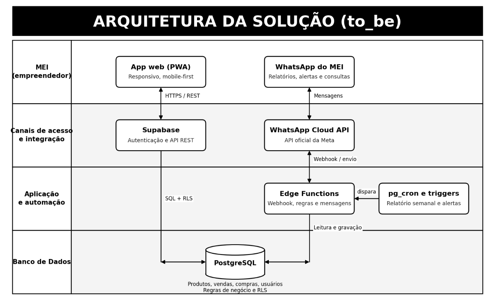
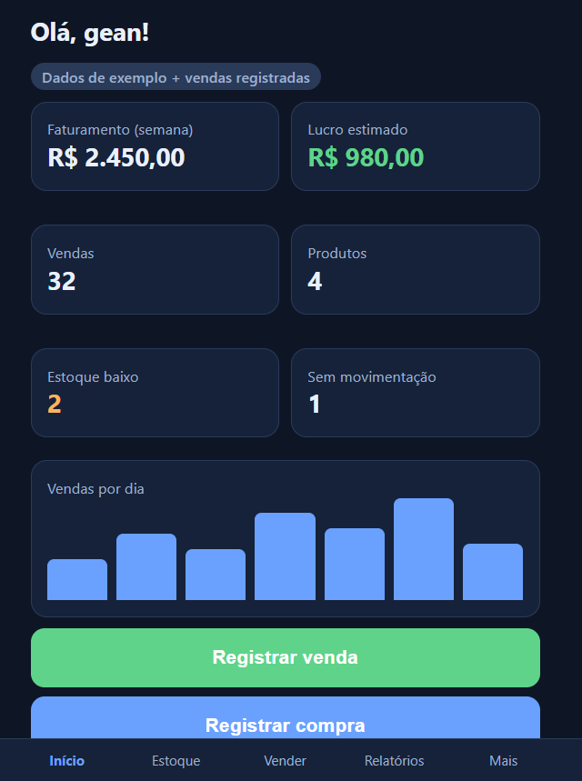
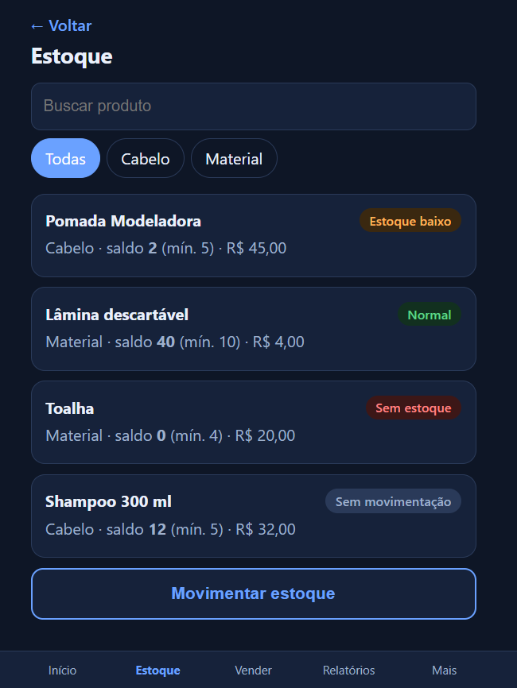
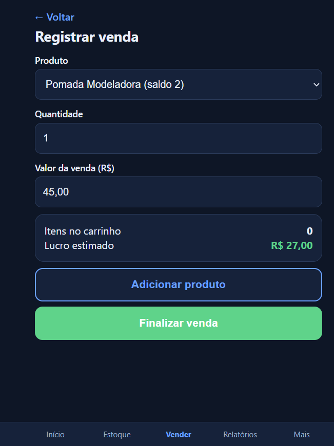
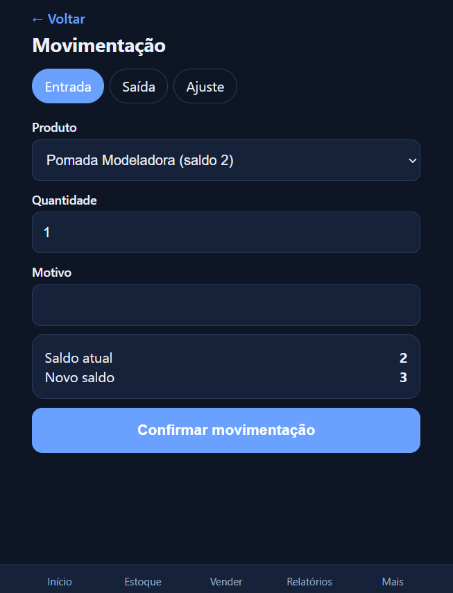
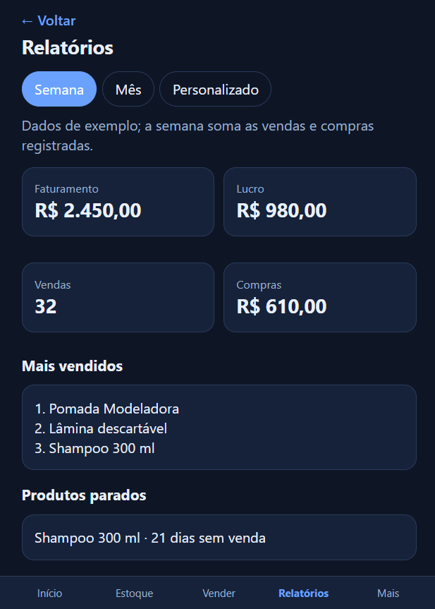
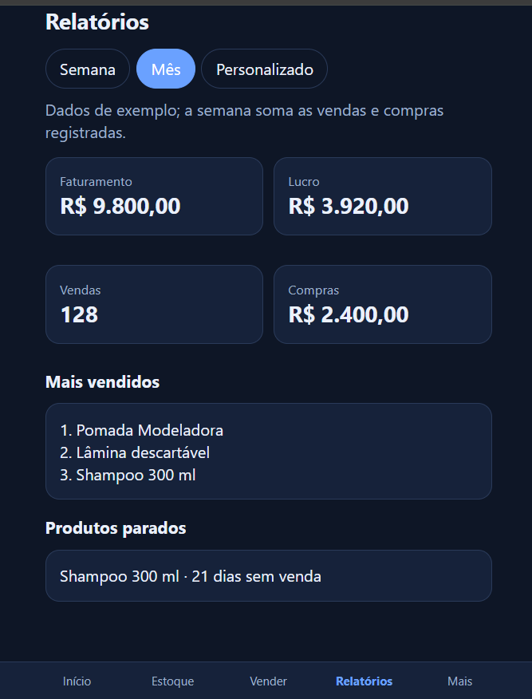
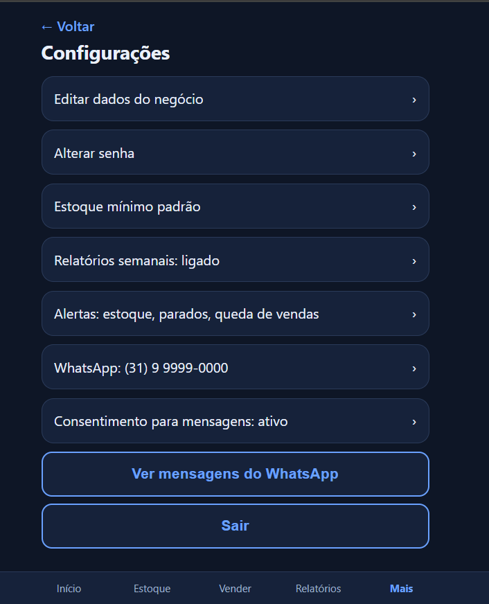
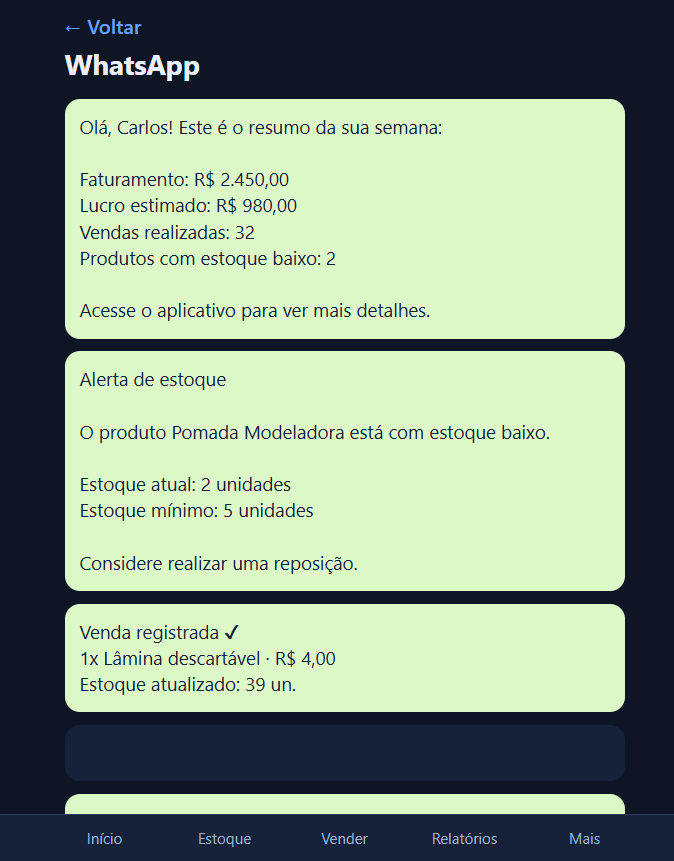
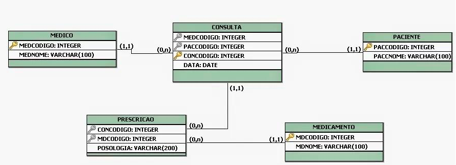

## 4. Projeto da Solução

Pré-requisitos: <a href="03-Modelagem do Processo de Negocio.md"> Modelagem do Processo de Negocio</a>

## 4.1. Arquitetura da solução

A solução possui dois canais de acesso: o **Aplicativo Web (PWA)**, utilizado
para cadastrar produtos, registrar vendas e compras e consultar o estoque, e o
**WhatsApp Business**, utilizado para receber relatórios, alertas e realizar
consultas. Os dois canais compartilham as mesmas regras de negócio e os mesmos
dados.

Como o projeto não terá um backend próprio, o **Supabase (BaaS — Backend as a
Service)** será utilizado como camada de aplicação, fornecendo autenticação e
**API REST**. O **PostgreSQL** será o banco de dados e armazenará usuários, produtos, vendas, compras e
movimentações de estoque. Suas regras de negócio, como impedir vendas acima do
saldo e atualizar o estoque após uma venda ou compra, serão implementadas por
meio de **triggers**, **views** e políticas de segurança **RLS (Row Level
Security)**.

As **Edge Functions** receberão as mensagens da **WhatsApp Cloud API**,
interpretarão as solicitações e consultarão ou atualizarão o banco. O
**pg_cron** executará a rotina do relatório semanal, enquanto as **triggers**
poderão disparar alertas quando o estoque atingir o nível mínimo. Os relatórios
e alertas serão enviados por **templates aprovados pela Meta**. Dessa forma, a
arquitetura centraliza os dados e as regras da solução, mantém a consistência
entre os canais e respeita a restrição de não desenvolver um backend próprio.

#### Módulos e tecnologias da solução

- **Aplicativo Web (PWA):** cadastro de produtos, registro de vendas e compras
  e consulta do estoque.
- **WhatsApp Business:** envio de relatórios, alertas e realização de consultas.
- **Supabase (BaaS):** autenticação e disponibilização da API da aplicação.
- **API REST:** comunicação entre o aplicativo e os serviços do Supabase.
- **PostgreSQL:** armazenamento de usuários, produtos, vendas, compras e
  movimentações de estoque.
- **Triggers e views:** aplicação das regras de negócio, atualização do estoque
  e cálculo de indicadores financeiros.
- **RLS (Row Level Security):** controle de acesso aos dados de cada MEI.
- **Edge Functions:** processamento de mensagens, regras e integrações.
- **WhatsApp Cloud API:** comunicação oficial com o WhatsApp Business.
- **pg_cron:** execução programada do relatório semanal.
- **Templates da Meta:** padronização dos relatórios e alertas enviados
  proativamente.
 

### 4.2. Protótipos de telas

O protótipo foi desenvolvido com foco em uma interface simples, responsiva e
mobile-first, adequada para MEIs com pouca familiaridade tecnológica. A
navegação utiliza um menu inferior com as opções **Início**, **Estoque**,
**Vender**, **Relatórios** e **Mais**, facilitando o acesso às funções
principais do sistema.

O protótipo contempla as seguintes telas:

- **Dashboard:** apresenta faturamento, lucro estimado, quantidade de vendas,
  produtos cadastrados, estoque baixo, produtos sem movimentação e ações rápidas
  para registrar venda ou compra.
- **Estoque:** permite buscar produtos, filtrar por categoria e visualizar o
  saldo, o estoque mínimo e a situação de cada item.
- **Registrar venda:** permite selecionar o produto, informar a quantidade e o
  valor da venda, visualizar o lucro estimado e finalizar a operação.
- **Movimentação:** permite registrar entradas, saídas e ajustes, exibindo o
  saldo atual e o novo saldo após a operação.
- **Relatórios:** apresenta faturamento, lucro, vendas, compras, produtos mais
  vendidos e produtos parados, com filtros por semana, mês ou período
  personalizado.
- **Configurações:** reúne opções para editar os dados do negócio, configurar
  estoque mínimo, relatórios, alertas e o número de WhatsApp.
- **WhatsApp:** representa o recebimento de relatórios semanais, alertas de
  estoque baixo e confirmações de vendas.

As telas atendem aos requisitos de cadastro e controle de estoque, registro de
vendas e compras, cálculo de indicadores e envio de informações pelo WhatsApp.
Os botões de ação rápida, os campos objetivos e os indicadores visuais foram
utilizados para reduzir o tempo de registro e a sobrecarga mental do MEI.

#### Telas do protótipo

**Dashboard**

**Estoque**

**Registro de venda**

**Movimentação de estoque**

**Relatório semanal**

**Relatório mensal**

**Configurações**

**WhatsApp**

**Link para o protótipo no Figma:** [Acessar protótipo](https://www.figma.com/design/SjoPbWQOY0oFrNnij9djJn/Gest%C3%A3o-Inteligente?node-id=0-1&t=sctLCehfbaG3vDYs-1)

## Diagrama de Classes

O diagrama de classes ilustra graficamente como será a estrutura do software, e como cada uma das classes da sua estrutura estarão interligadas. Essas classes servem de modelo para materializar os objetos que executarão na memória.

As referências abaixo irão auxiliá-lo na geração do artefato “Diagrama de Classes”.

> - [Diagramas de Classes - Documentação da IBM](https://www.ibm.com/docs/pt-br/rational-soft-arch/9.6.1?topic=diagrams-class)
> - [O que é um diagrama de classe UML? | Lucidchart](https://www.lucidchart.com/pages/pt/o-que-e-diagrama-de-classe-uml)

## Modelo ER

O Modelo ER representa através de um diagrama como as entidades (coisas, objetos) se relacionam entre si na aplicação interativa.]

As referências abaixo irão auxiliá-lo na geração do artefato “Modelo ER”.

> - [Como fazer um diagrama entidade relacionamento | Lucidchart](https://www.lucidchart.com/pages/pt/como-fazer-um-diagrama-entidade-relacionamento)

### 4.3. Modelo de dados

O desenvolvimento da solução proposta requer a existência de bases de dados que permitam efetuar os cadastros de dados e controles associados aos processos identificados, assim como recuperações.
Utilizando a notação do DER (Diagrama Entidade e Relacionamento), elaborem um modelo, na ferramenta visual indicada na disciplina, que contemple todas as entidades e atributos associados às atividades dos processos identificados. Deve ser gerado um único DER que suporte todos os processos escolhidos, visando, assim, uma base de dados integrada. O modelo deve contemplar, também, o controle de acesso de usuários (partes interessadas dos processos) de acordo com os papéis definidos nos modelos do processo de negócio.
_Apresente o modelo de dados por meio de um modelo relacional que contemple todos os conceitos e atributos apresentados na modelagem dos processos._

#### 4.3.1 Modelo ER

O Modelo ER representa através de um diagrama como as entidades (coisas, objetos) se relacionam entre si na aplicação interativa.]

As referências abaixo irão auxiliá-lo na geração do artefato “Modelo ER”.

> - [Como fazer um diagrama entidade relacionamento | Lucidchart](https://www.lucidchart.com/pages/pt/como-fazer-um-diagrama-entidade-relacionamento)

#### 4.3.2 Esquema Relacional

O Esquema Relacional corresponde à representação dos dados em tabelas juntamente com as restrições de integridade e chave primária.
 
As referências abaixo irão auxiliá-lo na geração do artefato “Esquema Relacional”.

> - [Criando um modelo relacional - Documentação da IBM](https://www.ibm.com/docs/pt-br/cognos-analytics/10.2.2?topic=designer-creating-relational-model)

---

#### 4.3.3 Modelo Físico

Insira aqui o script de criação das tabelas do banco de dados.

Veja um exemplo:

<code>

 -- Criação da tabela Médico
CREATE TABLE Medico (
    MedCodigo INTEGER PRIMARY KEY,
    MedNome VARCHAR(100)
);

-- Criação da tabela Paciente
CREATE TABLE Paciente (
    PacCodigo INTEGER PRIMARY KEY,
    PacNome VARCHAR(100)
);

-- Criação da tabela Consulta
CREATE TABLE Consulta (
    ConCodigo INTEGER PRIMARY KEY,
    MedCodigo INTEGER,
    PacCodigo INTEGER,
    Data DATE,
    FOREIGN KEY (MedCodigo) REFERENCES Medico(MedCodigo),
    FOREIGN KEY (PacCodigo) REFERENCES Paciente(PacCodigo)
);

-- Criação da tabela Medicamento
CREATE TABLE Medicamento (
    MdcCodigo INTEGER PRIMARY KEY,
    MdcNome VARCHAR(100)
);

-- Criação da tabela Prescricao
CREATE TABLE Prescricao (
    ConCodigo INTEGER,
    MdcCodigo INTEGER,
    Posologia VARCHAR(200),
    PRIMARY KEY (ConCodigo, MdcCodigo),
    FOREIGN KEY (ConCodigo) REFERENCES Consulta(ConCodigo),
    FOREIGN KEY (MdcCodigo) REFERENCES Medicamento(MdcCodigo)
);

</code>

Este script deverá ser incluído em um arquivo .sql na pasta src\bd.

### 4.4. Tecnologias

_Descreva qual(is) tecnologias você vai usar para resolver o seu problema, ou seja, implementar a sua solução. Liste todas as tecnologias envolvidas, linguagens a serem utilizadas, serviços web, frameworks, bibliotecas, IDEs de desenvolvimento, e ferramentas._

Apresente também uma figura explicando como as tecnologias estão relacionadas ou como uma interação do usuário com o sistema vai ser conduzida, por onde ela passa até retornar uma resposta ao usuário.

| **Dimensão**   | **Tecnologia**  |
| ---            | ---             |
| SGBD           | MySQL           |
| Front end      | HTML+CSS+JS     |
| Back end       | Java SpringBoot |
| Deploy         | Github Pages    |
