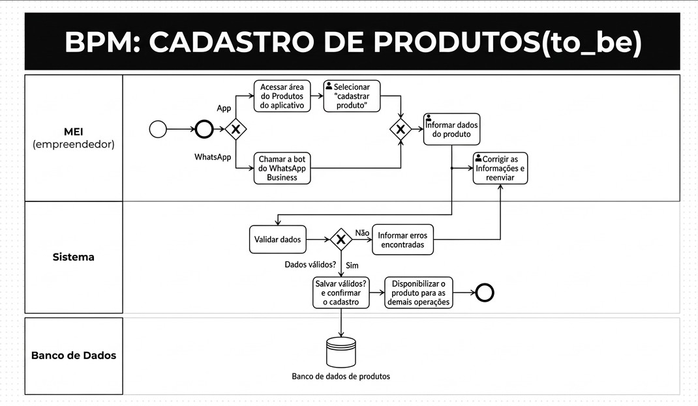
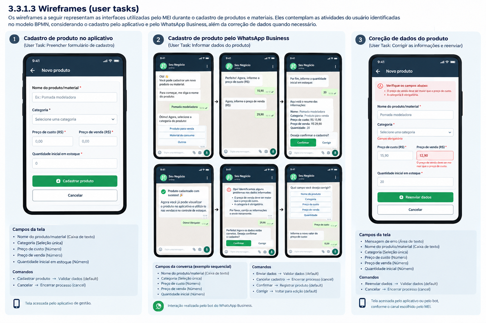

### 3.3.1 Processo 1 – Cadastro de Produtos e Materiais

O processo de cadastro de produtos e materiais tem como objetivo permitir que o Microempreendedor Individual (MEI) registre os produtos comercializados e os materiais utilizados em seu negócio, mantendo as informações necessárias para o controle de estoque e para os cálculos financeiros realizados pelo sistema.

O cadastro pode ser realizado por dois canais: a interface do aplicativo de gestão ou o bot integrado ao WhatsApp Business. Essa alternativa busca reduzir o esforço do empreendedor, permitindo que ele escolha o canal mais conveniente para sua rotina, sem precisar necessariamente abrir o aplicativo para cadastrar um produto.

**Onde acontece:** no aplicativo de gestão ou na conversa com o bot do WhatsApp Business. A validação e o registro das informações ocorrem por meio dos mecanismos utilizados pela solução.

**Participantes:**

- **MEI/empreendedor:** fornece as informações necessárias para o cadastro e corrige eventuais dados inválidos.
- **Bot do WhatsApp Business:** conduz a conversa, solicita as informações do produto e apresenta mensagens de retorno quando o cadastro é realizado por esse canal.
- **Aplicativo/sistema:** recebe e valida os dados, registra o produto e disponibiliza suas informações para consulta.
- **Banco de dados:** mantém os dados cadastrados para que possam ser consultados e utilizados nos demais processos da solução.

**Evento de início:** o MEI decide cadastrar um novo produto ou material e inicia a operação pelo aplicativo ou pelo WhatsApp Business.

**Tarefas do processo:**

1. Escolher o canal de cadastro (aplicativo ou WhatsApp).
2. Acessar a área de produtos do aplicativo e selecionar "Cadastrar produto", ou chamar o bot do WhatsApp Business.
3. Informar o nome, a categoria, o preço de custo, o preço de venda e a quantidade inicial em estoque.
4. Enviar os dados para validação.
5. Verificar se as informações estão completas e válidas.
6. Informar os erros encontrados e solicitar a correção dos dados, quando necessário.
7. Corrigir as informações e reenviá-las para nova validação.
8. Salvar o produto no banco de dados e confirmar o cadastro quando todas as informações estiverem válidas.
9. Disponibilizar o produto para as demais operações da solução.

**Evento de fim:** o produto é registrado com sucesso e fica disponível para consulta no aplicativo e para utilização nos processos seguintes.

**Produto final:** produto ou material cadastrado, contendo nome, categoria, preço de custo, preço de venda e quantidade inicial em estoque.

##### 3.3.1.1 Modelagem BPMN

##### 3.3.1.2 Detalhamento das atividades do usuário (user tasks)

#### Detalhamento das atividades

As atividades do usuário representam as interações realizadas pelo MEI durante o processo de cadastro de produtos e materiais. Conforme o modelo BPMN apresentado, essas atividades envolvem a seleção da opção de cadastro no aplicativo, o fornecimento dos dados do produto e a correção das informações quando o sistema identifica erros.

O cadastro pode ser iniciado pelo aplicativo ou pelo bot do WhatsApp Business. As atividades descritas a seguir consideram os campos necessários para o cadastro e os comandos que direcionam o fluxo para as próximas etapas do processo.

**Selecionar a opção "Cadastrar produto"**

Esta atividade permite que o MEI acesse a funcionalidade de cadastro de produtos e materiais pela interface do aplicativo.

| **Campo**         | **Tipo**      | **Restrições**                                       | **Valor default**         |
| ---               | ---           | ---                                                  | ---                       |
| Opção de cadastro | Seleção única | Deve permitir selecionar a opção "Cadastrar produto" | Nenhuma opção selecionada |

| **Comandos**      | **Destino**               | **Tipo** |
| ---               | ---                       | ---      |
| Cadastrar produto | Informar dados do produto | default  |

**Informar dados do produto**

Esta atividade permite que o MEI forneça as informações necessárias para cadastrar um produto ou material. A interação pode ocorrer pelo formulário do aplicativo ou pela conversa com o bot do WhatsApp Business.

| **Campo**                     | **Tipo**       | **Restrições**                                                | **Valor default**             |
| ---                           | ---            | ---                                                           | ---                           |
| Nome do produto/material      | Caixa de texto | Obrigatório; não pode conter apenas espaços                   | Vazio                         |
| Categoria                     | Seleção única  | Obrigatória; deve corresponder a uma categoria disponível     | Nenhuma categoria selecionada |
| Preço de custo                | Número         | Obrigatório; deve ser maior ou igual a zero                   | Vazio                         |
| Preço de venda                | Número         | Obrigatório; deve ser maior ou igual a zero                   | Vazio                         |
| Quantidade inicial em estoque | Número         | Obrigatória; deve ser um número inteiro maior ou igual a zero | 0                             |

| **Comandos**      | **Destino**                      | **Tipo** |
| ---               | ---                              | ---      |
| Cadastrar produto | Validar dados                    | default  |
| Cancelar          | Encerrar processo                | cancel   |
| Confirmar         | Validar dados (via WhatsApp)     | default  |
| Corrigir          | Voltar para edição (via WhatsApp)|          |

Após o envio, o sistema verifica se as informações estão completas e atendem às regras de validação definidas para o cadastro. Se forem identificados erros, o processo segue para a atividade de correção. Caso os dados sejam válidos, o sistema salva o produto no banco de dados, confirma o cadastro e o disponibiliza para as demais operações.

**Corrigir as informações e reenviar**

Esta atividade é executada quando o sistema identifica informações ausentes ou inválidas durante a validação. O MEI recebe uma mensagem indicando os problemas encontrados, corrige os campos necessários e envia novamente as informações para uma nova validação.

| **Campo**                     | **Tipo**       | **Restrições**                                                       | **Valor default**            |
| ---                           | ---            | ---                                                                  | ---                          |
| Mensagem de erro              | Área de texto  | Exibida pelo sistema; deve indicar os dados que precisam de correção | Mensagem gerada pelo sistema |
| Nome do produto/material      | Caixa de texto | Obrigatório; não pode conter apenas espaços                          | Último valor informado       |
| Categoria                     | Seleção única  | Obrigatória; deve corresponder a uma categoria disponível            | Última categoria informada   |
| Preço de custo                | Número         | Obrigatório; deve ser maior ou igual a zero                          | Último valor informado       |
| Preço de venda                | Número         | Obrigatório; deve ser maior ou igual a zero                          | Último valor informado       |
| Quantidade inicial em estoque | Número         | Obrigatória; deve ser um número inteiro maior ou igual a zero        | Último valor informado       |

| **Comandos**                    | **Destino**       | **Tipo** |
| ---                             | ---               | ---      |
| Reenviar dados                  | Validar dados     | default  |
| Cancelar                        | Encerrar processo | cancel   |

Após o reenvio, o sistema realiza uma nova validação. Se os dados continuarem inválidos, o MEI deverá corrigir as informações novamente. Se estiverem corretos, o produto será registrado e ficará disponível para consulta no aplicativo.

##### 3.3.1.3 Wireframes (user tasks)

Os wireframes representam as interfaces utilizadas pelo MEI durante o cadastro de produtos e materiais, considerando o cadastro pelo aplicativo e pelo WhatsApp Business, além da correção de dados quando necessário.

**1. Cadastro de produto no aplicativo** (user task: preencher formulário de cadastro) — tela acessada pelo aplicativo de gestão.

- Campos da tela: Nome do produto/material (Caixa de texto), Categoria (Seleção única), Preço de custo (Número), Preço de venda (Número) e Quantidade inicial em estoque (Número).
- Comandos: *Cadastrar produto* → Validar dados (default); *Cancelar* → Encerrar processo (cancel).

**2. Cadastro de produto pelo WhatsApp Business** (user task: informar dados do produto) — interação realizada pelo bot do WhatsApp Business.

- Campos da conversa (exemplo sequencial): Nome do produto/material (Caixa de texto), Categoria (Seleção única: Produto para venda, Material de consumo ou Outros), Preço de custo (Número), Preço de venda (Número) e Quantidade inicial (Número).
- Ao final, o bot apresenta o resumo das informações e pergunta se o MEI deseja confirmar o cadastro.
- Comandos: *Enviar dados* → Validar dados (default); *Cancelar cadastro* → Encerrar processo (cancel); *Confirmar* → Registrar produto (default); *Corrigir* → Voltar para edição (default).

**3. Correção de dados do produto** (user task: corrigir as informações e reenviar) — tela acessada pelo aplicativo ou pelo bot, conforme o canal escolhido pelo MEI.

- Campos da tela: Mensagem de erro (Área de texto), Nome do produto/material (Caixa de texto), Categoria (Seleção única), Preço de custo (Número), Preço de venda (Número) e Quantidade inicial (Número).
- No WhatsApp, o bot informa os problemas encontrados e pergunta qual campo o MEI deseja corrigir (nome, categoria, preço de custo, preço de venda ou quantidade).
- Comandos: *Reenviar dados* → Validar dados (default); *Cancelar* → Encerrar processo (cancel).